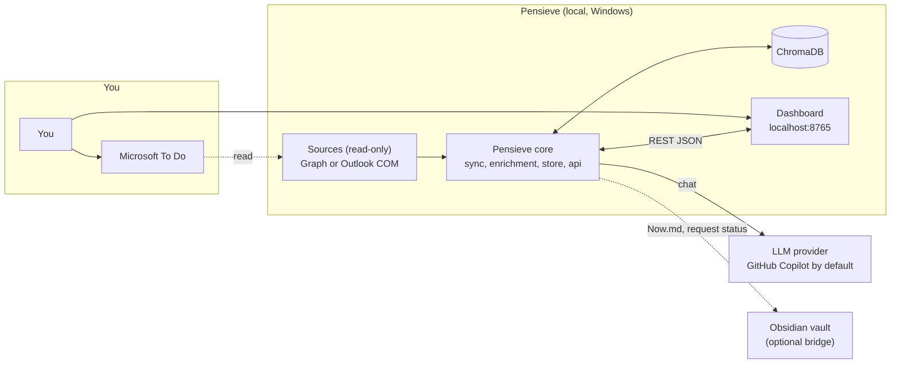
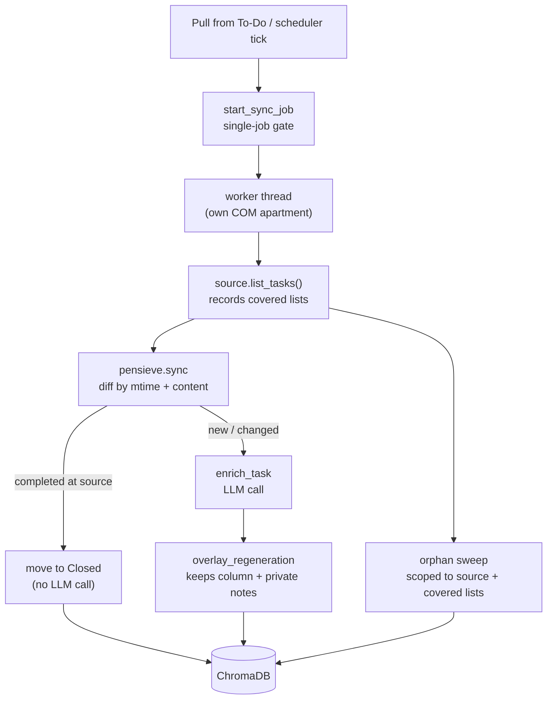

# Pensieve

> *Stir the surface and look within.*

Pensieve is a local, single-user Windows app that pulls your Microsoft To Do tasks, enriches each one with an LLM, stores the result in a local vector database, and lays it out on a Harry Potter themed kanban dashboard organized around your annual goals.

It runs on your machine. Tasks come from Microsoft To Do (personal Microsoft accounts, via Microsoft Graph) or from classic Outlook on this PC (via COM). The AI is GitHub Copilot by default. Enrichments live in a local ChromaDB, and the dashboard is a static page served by a local FastAPI server, opened in its own window by `desktop\Pensieve.exe`.

> **New here?** [SETUP.md](SETUP.md) gets you from clone to first sync. To hand a copy to a friend, build the installer described in [desktop/SHARING.md](desktop/SHARING.md); installed copies keep their data in `%LOCALAPPDATA%\Pensieve`.

---

## Table of contents

1. [Why this exists](#why-this-exists)
2. [What it does](#what-it-does)
3. [Core concepts](#core-concepts)
4. [Connect Goals and Houses](#connect-goals-and-houses)
5. [What Pensieve writes, and when](#what-pensieve-writes-and-when)
6. [Auto-sync](#auto-sync)
7. [Architecture](#architecture)
8. [Quickstart](#quickstart)
9. [The dashboard](#the-dashboard)
10. [Configuration](#configuration)
11. [Repository layout](#repository-layout)
12. [Hard constraints](#hard-constraints)
13. [Current status](#current-status)
14. [Design notes](#design-notes)
15. [License and acknowledgements](#license-and-acknowledgements)

---

## Why this exists

Microsoft To Do is good at capturing tasks. It is not good at telling you:

- which of those tasks actually move the needle on your annual goals
- which ones share a thread (the same strand of work) and could be batched
- which ones are low-impact admin you should just power through
- what the past six weeks of your work has actually been about
- which finished tasks deserve to be remembered as evidence of impact

Pensieve sits next to To Do, reads your tasks, and answers those questions in a parallel local store you can explore, search, and reflect against.

The mental model is from the books: a Pensieve is a basin where you store and revisit memories. Captured tasks become Memories. Memories you take depth on become Dives. Work that needs another look goes to Review. Closed work can be captured as a Vial: a sentence of evidence about what changed.

## What it does

- **Pulls** tasks read-only from the source you pick in **More > Accounts**: Microsoft To Do through Graph (personal Microsoft accounts), or classic Outlook desktop through COM.
- **Enriches** each new or changed task with one LLM call: which Strand it belongs to, its real why and impact, which Connect Goals it serves, and how confident the model is. GitHub Copilot is the default provider; **More > AI models** picks the model per job (sync enrichment, recaps, goals import, voice capture).
- **Stores** every enriched task in a local ChromaDB with an embedding, so the whole corpus is semantically searchable.
- **Serves** a local FastAPI on `http://localhost:8765` and the dashboard on top of it. `desktop\Pensieve.exe` starts the backend hidden and opens the dashboard in an Edge app window.
- **Speak a task**: dictate a task, Copilot drafts it, and nothing is created in your list until you click Add.
- **Vault bridge** (optional): keeps a `Now.md` note in an Obsidian vault for other agents, and lists task requests they file under **From your agents**.
- **Recap, Graph, Docs**: Connect-format recaps per goal, a constellation graph of your work, and an in-app notes hub.

## Core concepts

| Concept | What it is | Where it lives |
| ------- | ---------- | -------------- |
| **Task** | A row from Microsoft To Do (or an Outlook task), pulled read-only | To Do / Outlook, mirrored into Pensieve only as input |
| **Strand** | A named recurring thread of work (DORA RFI Responses, NIS2 Crosswalk, 1:1 Prep, etc.) with a `kind` (deep, tactical, learning, writing) and optional Connect Goal mapping | `data/samples.json` `strand_catalog` (you maintain it) |
| **Memory** | An enriched task: Strand, why, impact, confidence scores, Connect Goal alignments | `data/chroma/` |
| **Lifecycle column** | Memory, Dive, Review, Closed. You drag cards; your placement survives re-syncs. Tasks completed in To Do auto-route to Closed. | Chroma metadata |
| **Connect Goal** | One of your annual goals. Each Memory aligns to zero, one, or several. Any number of goals works. | `data/connect-goals.json` |
| **Lane / House** | The color slot a goal maps to. The API stores a neutral `lane` slug; the dashboard shows it as a House. | Inside each goal record |
| **Vial** | A closure-capture record: one sentence about what changed when a card closed, with a frozen snapshot of the card. Vials outlive their task. | `data/chroma/` (`vials` collection) |

**Reverie** (scheduled focus blocks) is a planned Phase 2.5 concept; its prompts are pre-staged in `prompts/` but nothing is wired.

## Connect Goals and Houses

Connect Goals are the annual goals you set with your manager (Microsoft Connect is the inspiration; OKRs or any other annual framework work the same way). Every Memory gets aligned, or explicitly not aligned, to one or more goals during enrichment, with a confidence score and a short alignment note.

The board has two views: **Lifecycle** (the four columns) and **Houses** (one column per goal, plus Unhoused for unaligned work).

Populate goals in three ways, all saved to `data/connect-goals.json` through `POST /api/goals`:

1. **Upload your Connect PDF** under **More > Set goals** and click Parse with AI. Each goal gets a lane from an 8-slot palette (goals beyond eight cycle).
2. **Hand-edit** goals in the same editor.
3. **Edit `data/connect-goals.json`** directly.

Lane slugs (`crimson`, `gold`, `emerald`, `azure`, `slate`, `ember`, `sage`, `rose`) are stable keys in `LANE_PALETTE` (`pensieve/enrichment/goals_importer.py`) and the dashboard; [frontend-proto/README.md](frontend-proto/README.md) lists the House each one shows as.

## What Pensieve writes, and when

Sources are read-only. Every write Pensieve can make is listed here, and each has its own switch:

| Write | Default | What it touches |
| ----- | ------- | --------------- |
| Column mirror (`PENSIEVE_MIRROR_TO_SOURCE`) | off | Adds one `pensieve/col:<column>` category to an Outlook task when you drag its card, so a second PC sees the same board. Only categories with that prefix are ever touched. |
| Close writeback (`PENSIEVE_MIRROR_COMPLETION`) | off | Dragging a card to Closed marks the Outlook task complete (`MarkComplete()`). Close only: dragging out of Closed never reopens the task. |
| Voice capture (`PENSIEVE_ALLOW_TASK_CREATE`) | on | Creates a NEW task in your own list, only after you confirm the drafted card. Never edits, completes, or deletes an existing task. |
| Vault bridge (`PENSIEVE_VAULT_DIR`) | off | Writes `Agents/Pensieve/Now.md` in your vault, and only the `status`, `outcome`, and `outcome_date` fields of agent request notes you act on. Local files only. |

The column mirror and close writeback live in `pensieve/sources/outlook_com_sink.py` (the only module under `pensieve.sources` that calls `.Save()`); voice capture lives in `pensieve/capture/`; the bridge in `pensieve/bridge.py`.

### Cross-PC mirror mode

If you run Pensieve on two PCs against the same Outlook mailbox:

1. Set `PENSIEVE_MIRROR_TO_SOURCE=true` in `.env` on both PCs and restart.
2. Drag a card on PC-A. The task's Outlook Categories gain `pensieve/col:<column>`.
3. Sync on PC-B. The card lands in the matching column.

Conflict policy is source-wins-on-newer: if the task's `LastModificationTime` is newer than the local enrichment, the tag wins. Completion is terminal: a task completed in To Do lands in Closed regardless of the tag. The tag is visible to anyone the task is shared with, but it reveals only the column; enrichments never leave your machine.

To turn it off cleanly, set the flag back to `false`, then remove the `pensieve/col:*` categories by hand or with `OutlookCOMSink.clear_column_tag`. `scripts/backfill_mirror_tags.py` tags every existing Outlook memory once, for a second PC's first sync.

## Auto-sync

When the API starts, an `AutoSyncScheduler` runs the same code path as **Pull from To-Do** every `PENSIEVE_AUTO_SYNC_INTERVAL_SECONDS` (default 120; `0` disables it). It syncs `PENSIEVE_AUTO_SYNC_SOURCE` if set, else the source chosen in Accounts, and skips `sample_file`. Manual and scheduled syncs share one atomic single-job gate (`SyncJobTracker.try_begin`), so they never collide on Chroma's single writer. The dashboard re-reads memories every 30 seconds.

## Architecture



Sync flow (**Pull from To-Do**, or an auto-sync tick):



Key invariants:

- **Sources are read-only.** A unit test asserts no source class has a mutation method.
- **One sync at a time.** ChromaDB is single-writer; the tracker refuses a second sync while one runs.
- **Completed tasks skip the LLM.** They move to Closed with a metadata-only update.
- **Your edits survive.** `overlay_regeneration` keeps your column and private notes when a task is re-enriched, and auto-sync never bumps the Garden "tended" timestamp.
- **The orphan sweep is conservative.** A narrow sync can only delete memories from lists it actually read, closed memories are never deleted (sources stop listing old completed tasks), and the sweep is skipped entirely when any task failed to read.

**Regenerate** on a card re-runs enrichment for that one memory (`POST /api/memories/{id}/regenerate`) with the same overlay rules.

## Quickstart

See [SETUP.md](SETUP.md) for the full walkthrough. The short version:

```powershell
git clone https://github.com/andy-herman/pensieve
cd pensieve
python -m venv .venv
.\.venv\Scripts\Activate.ps1
pip install -e ".[dev]"
Copy-Item .env.example .env

pensieve init                                   # config, provider, model, source
pensieve sync --source sample_file --dry-run    # no LLM calls
pensieve serve                                  # http://localhost:8765/
.\desktop\build.ps1                             # optional: Pensieve.exe + shortcuts
```

On first open, the dashboard's **Connect your accounts** screen signs in to Microsoft To Do and GitHub Copilot and picks the task source. Other CLI commands: `pensieve status`, `pensieve search "<query>"`, `pensieve goals`, `pensieve lists` (Outlook folders), and `pensieve sync --source outlook_com --list "<name>"` to narrow a sync.

## The dashboard

A single static page (`frontend-proto/`): plain HTML, CSS, and JavaScript, no build step. [frontend-proto/README.md](frontend-proto/README.md) covers it in detail.

- **Pages**: Board, Recap, Graph, Docs.
- **Board**: Lifecycle and Houses views, drag and drop, text filter as you type, semantic search on Enter, a review-queue counter, and a **This week** filter that hides older Closed cards without deleting them.
- **Cards**: AI-curated display title, strand, due date (editable in the card modal), freshness dot, and on closed cards a Vial capture prompt or captured count.
- **Garden**: a board-health score (click to filter to stale, ghost, and overdue cards), up to three daily quests with a clean-day streak, and nine achievement badges.
- **Toolbar**: **Speak a task**, **From your agents** (when the vault bridge has requests), **Pull from To-Do**, and **More** (Refresh, Set goals, AI models, Accounts, About & legal, card density).
- **Recap**: a Connect "Reflect on the past" draft per goal with run history, per-section revise, and DOCX export. Only lists in `PENSIEVE_RECAP_LIST_NAMES` feed it unless you override per call.
- **Graph**: goals and tasks as a force-directed constellation with alignment and semantic edges from the same embeddings as search.
- **Docs**: markdown notes and SOPs under `data/docs/`.
- **Themes**: Day (parchment), Night, and a hidden Marauder theme.

If the API is unreachable, the board falls back to bundled seed memories and says "offline (seed data)" in the footer.

## Configuration

`.env` (copied from `.env.example`) holds the settings for a copy run from the repo; installed copies read the installer's `pensieve.env`, then `%LOCALAPPDATA%\Pensieve\pensieve.env`. Choices made in the app (task source, models) live in the data directory. The most important keys:

| Variable | Default | What it does |
| -------- | ------- | ------------ |
| `LLM_PROVIDER` | `github_copilot` | `github_copilot`, or a fallback: `azure_openai`, `github_models` |
| `COPILOT_GITHUB_USER` | (blank) | Optional: pin the GitHub login whose Copilot license is used (token from `gh auth token --user`). Blank uses the Copilot sign-in from the Accounts screen. |
| `COPILOT_MODEL` | `gpt-5.4` | Default model; **More > AI models** overrides it per job (saved in `data/ai-models.json`) |
| `COPILOT_CLI_PATH` | (blank) | Copilot CLI binary; blank finds an npm or winget install, or `copilot.exe` on PATH |
| `AZURE_OPENAI_ENDPOINT`, `AZURE_OPENAI_DEPLOYMENT` | | Only for `azure_openai` (keyless via `DefaultAzureCredential`, or `AZURE_OPENAI_API_KEY`) |
| `GITHUB_TOKEN`, `GITHUB_MODELS_MODEL` | | Only for `github_models` (PAT with `models:read`) |
| `PENSIEVE_DEFAULT_SOURCE` | `sample_file` | Fallback task source when none is chosen in Accounts: `sample_file`, `outlook_com`, `personal_graph` |
| `PERSONAL_GRAPH_CLIENT_ID` | (blank) | Public client id of the Pensieve app registration for Microsoft To Do sign-in ([desktop/SHARING.md](desktop/SHARING.md)) |
| `PENSIEVE_ALLOW_TASK_CREATE` | `true` | Lets Speak a task (and agent requests) create new tasks after you confirm |
| `PENSIEVE_VAULT_DIR` / `PENSIEVE_VAULT_LISTS` | (blank) | Obsidian vault for the bridge (blank = off) / lists agents may see (blank = all) |
| `PENSIEVE_MIRROR_TO_SOURCE` | `false` | Column mirror to Outlook categories |
| `PENSIEVE_MIRROR_COMPLETION` | `false` | Close writeback to Outlook |
| `PENSIEVE_AUTO_SYNC_INTERVAL_SECONDS` | `120` | Auto-sync interval; `0` disables |
| `PENSIEVE_AUTO_SYNC_SOURCE` | (blank) | Source for auto-sync; blank uses the Accounts choice |
| `PENSIEVE_RECAP_LIST_NAMES` | `CISO GRC` | Comma-separated list names that feed recaps; blank disables the filter |
| `PENSIEVE_BACKEND_PORT` | `8765` | API port |
| `PENSIEVE_DATA_DIR` | `data/` in the repo (`%LOCALAPPDATA%\Pensieve\data` when installed) | Chroma, goals, samples, audit log, app choices |
| `PENSIEVE_ENRICHMENT_CONFIDENCE_THRESHOLD` | `0.6` | Below this, a memory goes to the review queue |
| `PENSIEVE_ENRICHMENT_CONCURRENCY` | `3` | Tasks enriched in parallel |

`.env.example` documents the rest.

## Repository layout

```
pensieve/
|-- pensieve/                  Python package
|   |-- api/                   server.py (FastAPI routes + dashboard mount), security.py (session key, CSP)
|   |-- capture/               Speak a task: draft (parse.py) and create (creators.py)
|   |-- enrichment/            chat_provider (factory), copilot_client, llm_client (Azure),
|   |                          github_models_client, enricher, prompt, connect_goals, goals_importer
|   |-- sources/               Read-only TaskSources (outlook_com, personal_graph, sample_file)
|   |                          plus the opt-in TaskSink (sink.py, outlook_com_sink.py)
|   |-- store/                 ChromaDB stores (chroma.py, vials.py), schema, read cache, embedder
|   |-- ai_prefs.py            Per-job model choice (AI models panel)
|   |-- bridge.py              Obsidian vault bridge
|   |-- connections.py         Accounts screen: Microsoft and Copilot sign-in, task source choice
|   |-- cli.py                 Typer CLI
|   |-- config.py              Settings from .env
|   |-- sync.py, sync_state.py, scheduler.py   Sync orchestrator, job gate, auto-sync
|   |-- garden.py, quests.py, quest_state.py, achievements.py, achievement_state.py   Garden
|   |-- recap.py, recap_export.py, recap_history.py, graph.py, docs_store.py
|
|-- frontend-proto/            Dashboard (HTML/CSS/JS + rendered art in assets/)
|-- desktop/                   Pensieve.exe launcher source, build and icon scripts,
|                              installer/ (PyInstaller + Inno Setup build), SHARING.md
|-- prompts/                   LLM system prompts (markdown)
|-- tools/                     Optional backend auto-start helpers
|-- scripts/                   Legacy Phase 0 PowerShell (reference only) + mirror-tag backfill
|-- data/                      samples.json, connect-goals.json; runtime data is gitignored
|-- tests/                     pytest suite
|-- LICENSE                    MIT
|-- AGENTS.md, CLAUDE.md       Rules for AI coding agents
|-- SPEC.md, PHASES.md, OPEN-QUESTIONS.md   Product spec, phased plan, open questions
```

## Hard constraints

1. **Sources are read-only.** No source class has a mutation method (enforced by `tests/test_sources.py`). The only writes are the ones in [What Pensieve writes](#what-pensieve-writes-and-when), each behind its own switch, and none edits a task's notes, subject, or due date.
2. **LLM calls go through `get_chat_client()` only**: GitHub Copilot by default (tools disabled, sessions deleted after each call), or Azure OpenAI / GitHub Models. No other endpoint.
3. **No corporate Microsoft Graph and no corporate app registrations.** Work tasks come from Outlook COM. The one Graph path is personal Microsoft To Do, through an app registration in a personal Entra directory.
4. **Local only.** No hosting, no remote storage, no telemetry (ChromaDB telemetry is disabled). Network traffic is limited to the LLM provider, Graph for a connected personal account, and the browser's speech service while dictating; fonts and art ship with the app.
5. **Single user, locked to this PC.** The API listens on `127.0.0.1`, answers only to `127.0.0.1` / `localhost`, and, when started by `Pensieve.exe`, refuses API calls without that launch's session key (`pensieve/api/security.py`). The dashboard runs under a Content-Security-Policy that allows only the app's own scripts. `pensieve serve` run by hand skips the session key, for development.
6. **Plain dashboard.** No build step; view source and read every line.
7. **Honest confidence.** Low-confidence enrichments land in the review queue rather than being shown as ground truth.

## Current status

Phase 1 (live To Do, enrichment, Chroma, dashboard) is the daily driver. Phase 2 (Vials) v1 is shipped; AI polish and recap integration for Vials are tracked in [issue #1](https://github.com/andy-herman/pensieve/issues/1). The Garden (v1 to v3), recaps, the graph, docs, the Accounts screen, the AI models panel, Speak a task, the vault bridge, and the desktop app are all live. Phase 2.5 (Reverie) and Phase 3 are planned; calendar work is parked. See [PHASES.md](PHASES.md).

Run `pytest` from the repo root to check the build; `tests/test_sources.py` guards the read-only contract.

## Design notes

- **The source ID is the Chroma ID.** Re-syncing a task upserts in place; duplicates cannot happen without breaking that contract.
- **Embedding text combines title, why, impact, alignment note, and notes**, so a search for a regulator or project name hits every layer.
- **Strands are human-maintained.** The LLM picks among them; if nothing fits, the memory is flagged for review rather than guessed.
- **Goal alignment is multi-label**, and operational or personal tasks get an empty alignment rather than a stretched one.
- **The audit log is append-only and gitignored** (`data/audit-log.jsonl`): every sync action with task id, source, reason, and token cost.

## License and acknowledgements

MIT; see [LICENSE](LICENSE). The app's **More > About & legal** page has the privacy notice, AI notice, and third-party notices.

The dashboard theme on this branch is a fan homage to the Harry Potter books, with no affiliation; strip it before any wider distribution (see [desktop/SHARING.md](desktop/SHARING.md)). Pensieve stands on ChromaDB, FastAPI, the GitHub Copilot SDK, and Microsoft To Do and Outlook.
